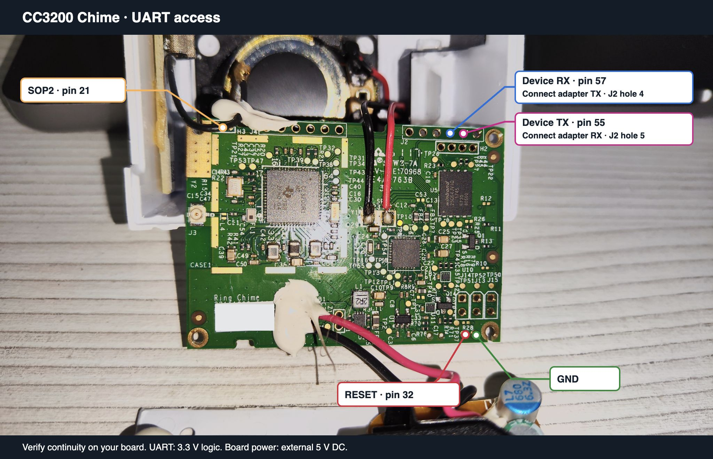
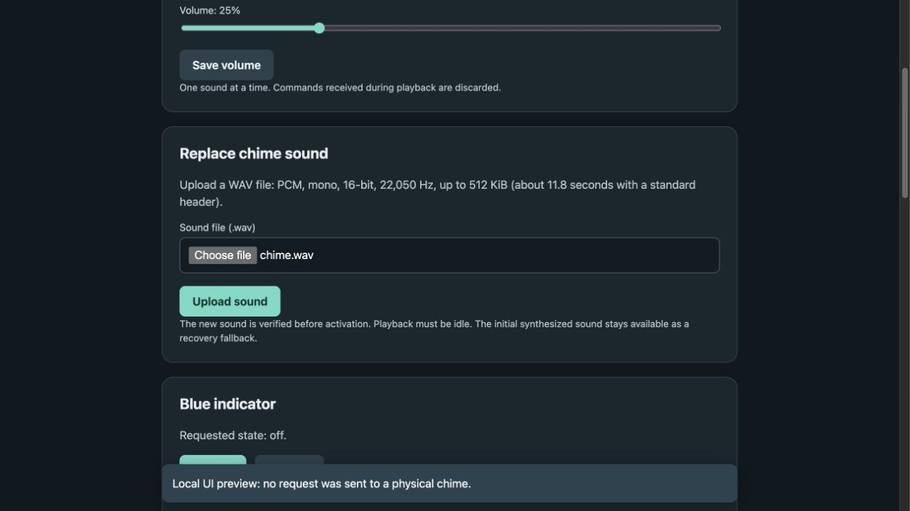

# Chime NG

Local Wi-Fi and MQTT firmware for the **CC3200 / TLV320DAC3100 Ring Chime**.
Reuse the original processor, DAC, amplifier, speaker and antenna with a simple
web interface and no Ring account or cloud service in the application.

This is an experimental project for the board shown below. It is
not a firmware for every product sold as a Ring Chime, and is not affiliated
with Ring, Amazon or Texas Instruments. Compare your hardware before proceeding.



## Why

This project started after replacing a Ring doorbell with a locally controlled
system. The goal is to keep using the Chime's existing Wi-Fi hardware and
speaker as a local sound alert for home automation.

## What it does

- Plays a sound through MQTT or the web interface.
- Lets you configure Wi-Fi, MQTT and volume in your browser.
- Accepts your own WAV sound uploads over Wi-Fi.
- Updates firmware through the web interface.

Build 0.2.1 has been validated on the board shown above.
Physical blue LED operation remains unresolved.
See [validation and limits](docs/validation.md).

## Start here

1. Read [hardware preparation and contact points](docs/hardware.md), including
   the separation of mains power from the low-voltage bench setup.
2. Follow [build instructions](docs/building.md).
3. Follow [initial UART installation](docs/flashing.md).
4. Configure Wi-Fi and MQTT through the web interface, then use the
   [MQTT contract](docs/mqtt.md).

For a local build on macOS or Linux, install Python 3.11 or later, Git, and
Clang (for the offline tests), then run from this directory:

```sh
python3 -m venv .venv
.venv/bin/python -m pip install -r requirements.txt
.venv/bin/pio run
.venv/bin/python -m pip install -r tools/requirements.txt
.venv/bin/python tests/run.py
```

The artifacts are in `.pio/build/chime-en/`. For first installation, follow
the [UART installation guide](docs/flashing.md). For later firmware updates,
rebuild with PlatformIO and upload the generated `.chime` file through the
device's web interface.
The setup password is generated at
`.pio/build/chime-en/setup-password.txt`; keep that file private.



## Repository layout

| Path | Purpose |
| --- | --- |
| `src/`, `include/`, `linker/` | Application, bootloader and hardware drivers |
| `platformio.ini`, `platforms/cc3200/` | Pinned ARM toolchain and SCons build graph |
| `vendor/ti/` | Unmodified, pinned TI driver and SimpleLink source subset |
| `web/en.html`, `locales/en.json` | English UI and HTTP messages selected at build time |
| `assets/chime.wav` | Synthesized default sound |
| `tools/` | UART first installation and recovery, plus their dependency list |
| `tests/` | Offline runner, local UI fixture and simulated UART/storage/network/peripheral faults |
| `docs/` | Wiring, first flash, runtime configuration and useful findings |

Initial flashing replaces the original startup firmware; no factory restore
procedure is provided.

## License

Chime NG firmware and project material are MIT licensed. TI sources retain
their BSD-style notices. The separate Python UART tools use GPL-2.0-or-later
to remain compatible with `cc3200tool`. See
[third-party notices](THIRD_PARTY_NOTICES.md) and
[redistribution guidance](docs/licensing.md), especially before distributing
firmware binaries or TI programming helpers.
