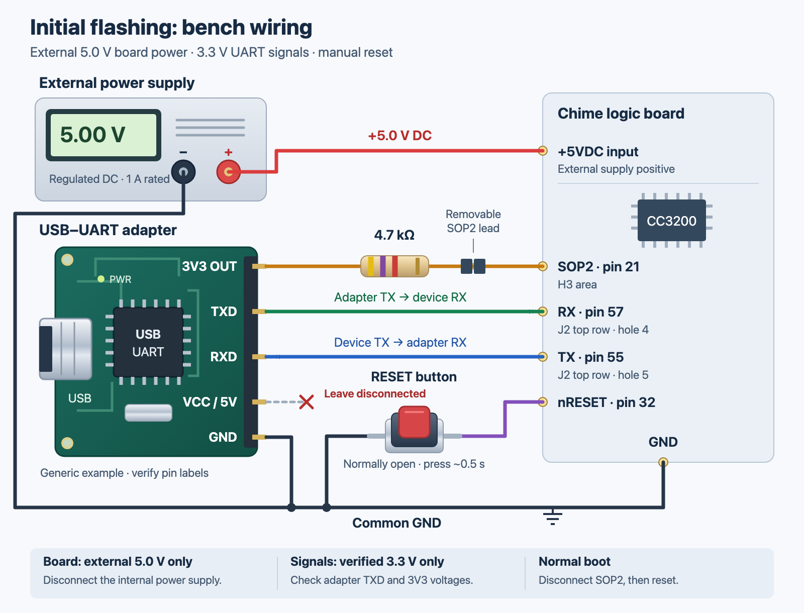

# First UART installation and recovery

PlatformIO builds the firmware for both initial installation and later updates.
The Python UART tools are only for first installation or recovery. After setup,
build updates with PlatformIO and upload the generated `.chime` file through
the device's web interface.

Read [hardware preparation](hardware.md) first. The procedure assumes the
shown CC3200 board, working 8 MiB serial flash and its existing TI network
processor firmware/service pack. It does **not** format blank flash or install
a TI service pack. **Initial flashing replaces the original startup firmware.
This project does not provide a factory restore procedure.**

## Equipment and wiring

- Regulated external 5.0 V DC supply. The tested setup used a supply rated
  for 1 A; allow for Wi-Fi startup current.
- USB UART adapter with verified 3.3 V TX/RX logic and 921600 baud support.
- 4.7 kOhm resistor, short Dupont leads, soldered header terminals and a
  momentary reset-to-ground lead or switch.
- Multimeter for unpowered continuity checks and powered DC voltage checks.

With all power disconnected, wire the following. The original mains supply
output must be disconnected from the logic board. The optional disconnected
speaker does not prevent UART programming.



Adapter pin order varies: follow its printed labels. Locate the board pads
using the [contact map](hardware.md#accessible-uart-contacts).

<details>
<summary>Connection table</summary>

| From | To |
| --- | --- |
| External supply +5.0 V | Board +5VDC input |
| External supply negative | Board GND and adapter GND |
| Adapter TXD (3.3 V logic) | Device RX, CC3200 pin 57 |
| Adapter RXD | Device TX, CC3200 pin 55 |
| Verified 3.3 V reference | 4.7 kOhm resistor → SOP2, CC3200 pin 21 |
| nRESET, CC3200 pin 32 | Normally open momentary button → GND |
| Adapter VCC / 5V | Leave disconnected |

</details>

Do not connect adapter VCC to the board's power input. If the adapter has a
separate verified 3.3 V output, it may be used only for the SOP2 reference
through the resistor. A selector marked 3.3 V does not prove both the VCC
output and UART logic are at 3.3 V; verify them. Never connect a 5 V output
to SOP2. DTR/RTS are unused in the manual-reset procedure.

For the reset button, use two contacts that are open when released and
connected only while pressed. Check with a multimeter before wiring.

## Enter the ROM loader

1. Keep SOP2 disconnected from its pull-up and RESET released initially.
   Close serial monitors; only one program can own the UART port.
2. Verify supply polarity and its 5.0 V output before connecting it. Enable
   the external supply, check that it stays regulated and inspect for
   unexpected current or heat. Resolve a current-limit event before proceeding.
3. Connect the USB UART to the computer with the common GND already wired.
4. Connect the verified 3.3 V reference through 4.7 kOhm to SOP2. With a
   voltmeter, confirm SOP2 is close to 3.3 V relative to GND.
5. Start the selected UART command. When it prints
   `Reset the device with SOP2 asserted and press Enter`, connect RESET to
   GND for about half a second, release it, then press Enter.
6. Keep SOP2 high for the whole installation session. Repeat the
   manual reset whenever the tool requests a new connection. The adapter
   normally stays connected between retries.

Entering the loader is not an erase operation. It speaks a binary protocol,
so the absence of text in a serial terminal does not mean it failed. The
loader tool uses 921600 baud; an application debug console uses 115200.

To find the adapter port:

```sh
.venv/bin/python -m serial.tools.list_ports
```

Use your own port in every command below, for example `/dev/cu.usbserial-XXXX`
on macOS or `/dev/ttyUSB0` on Linux.

## Install serial dependencies

Build the firmware as described in [building](building.md), then install the
serial-specific dependency list:

```sh
.venv/bin/python -m pip install -r tools/requirements.txt
```

## Plan, install and verify

Check the offline plan first:

```sh
.venv/bin/python tools/provision.py
```

This displays the installation plan without opening a serial port.
To perform the initial installation:

```sh
.venv/bin/python tools/provision.py -p YOUR_PORT --write
```

The installer checks local artifact hashes, CC3200 target identity, 8 MiB
flash capacity and this project's existing data files. A configured Chime NG
or conflicting application/boot record stops initial provisioning before
writes. Each newly written artifact is verified by reading it back:

| Order | Local artifact | Device path |
| ---: | --- | --- |
| 1 | `chime-ng-0.2.1.chime` | `/chime/slot0.bin` |
| 2 | `chime.wav` | `/chime/original.wav` |
| 3 | `boot-initial.bin` | `/chime/boot.bin`, mirrored |
| 4 | `chime-bootloader.bin` | `/sys/mcuimg.bin`, mirrored |

The loader is replaced last, after the application, sound and boot record
have been verified. Matching Chime NG data files are skipped. Repeating an
initial installation writes and verifies the loader again. An ambiguous
write result causes readback verification before any further operation. Inconsistent
reads stop installation. Use web OTA or the recovery updater once Chime NG
is configured; initial provisioning will not reset its configuration.

Do not boot normally until the tool reports `INSTALLATION VERIFIED`. If a
step fails, preserve the run logs under `.pio/build/chime-en/chime-install-*`,
keep SOP2 asserted, inspect the error and rerun the same command. Never format
flash as a response to an intermittent UART error. Those logs can contain
private data and must not be committed.

If a failed first installation left an incomplete Chime NG data file, the
default precheck stops at that mismatch. After inspecting the failed run,
add `--resume-initial` to the same `--write` command to explicitly permit
replacing incomplete project files. This is for interrupted initial setup,
not for normal updates. A configured unit or custom sound selection still
stops initial provisioning even with this flag.

## First normal boot and setup

1. Remove the SOP2 pull-up, then reset to boot Chime NG. Before later removing
   external power, also disconnect USB or the adapter's powered signal leads
   so they cannot partially power an unpowered board.
2. Join `ChimeSetup-<MAC suffix>` with the password from
   `.pio/build/chime-en/setup-password.txt`.
3. Open `http://192.168.4.1` manually. There is no captive portal redirect.
4. Sign in with that same password. Enter your 2.4 GHz Wi-Fi, MQTT broker,
   unique stable Homie ID, display name and a new admin password of at least
   12 characters. The HTTP Basic username is `admin`.
5. Save and reconnect to your normal Wi-Fi. Find the assigned address through
   DHCP, the UART console, or MQTT `system/ip`. Open `http://<device-ip>/`.
6. With power off, reconnect the speaker pair to its original pads, then
   power up and test at a modest volume. Verify audio and MQTT before closing
   the enclosure. The default volume is 25%.

If Wi-Fi does not obtain an address within 30 seconds, the firmware creates
the recovery AP. An existing admin password is still required. Recovery AP
mode is not a factory reset. Complete mechanical reassembly and insulation
before any eventual return to mains-powered operation; no exposed terminal
or test lead should remain able to contact the mains section.

## Later updates and recovery

### Replace the sound over Wi-Fi

Initial UART installation installs the included synthesized WAV. To replace
it, open **Replace chime sound** in the authenticated web interface.

The sound uploader accepts a PCM WAV file, mono, signed 16-bit, 22,050 Hz,
at most 512 KiB. With a standard 44-byte header that allows about 11.8 seconds.
The format/data chunk headers must be within the first 1 KiB, as required by
the embedded WAV reader. MP3, stereo and other sample rates are rejected.
Only upload sounds you have permission to use or distribute.

Wait for idle playback and boot confirmation, choose the `.wav` file, then
click **Upload sound**. The upload streams to the inactive sound file, passes
format and SHA-256 readback checks, and is then selected by a small mirrored
record. It takes effect immediately without recompilation or restart. The
previous sound file is not overwritten during that upload. An interrupted
upload leaves an unselected partial file. On boot, invalid selection records
or selected-file hashes fall back to the untouched initial `/chime/original.wav`.

The sound storage paths are `/chime/sound0.wav`, `/chime/sound1.wav` and
`/chime/sound.bin`. The two uploaded files each reserve up to 512 KiB, so the
filesystem needs roughly 1 MiB additional free space. Insufficient space
rejects an upload while preserving the selected file. The MQTT command
remains `original` and plays whichever sound is selected. Firmware OTA keeps
the selected sound.

### Update firmware over Wi-Fi

For routine updates, build the new firmware with PlatformIO:

```sh
.venv/bin/pio run -e chime-en
```

Upload the generated `.chime` file from `.pio/build/chime-en/` in the
authenticated web interface. No UART connection or Python flashing command
is needed. A firmware update preserves sound and loader. The
inactive slot is verified before selection; the new application confirms its
boot after a stable web listener. A failed or unconfirmed trial rolls back
on the next boot. SHA-256 detects corruption, not an untrusted publisher's
malicious firmware; see [security limits](validation.md).

### Recover over UART

If the web is unavailable but the Chime NG loader still works, enter ROM
loader mode again and use the UART recovery updater:

```sh
.venv/bin/python tools/update_uart.py
.venv/bin/python tools/update_uart.py -p YOUR_PORT --write
```

It preserves the active slot, loader, configuration and sound, verifies the
inactive image, and updates the existing mirrored boot record without
deleting it. The loader must match this build. If the installed loader was
built with an older compiler, provide its trusted original **Chime NG** binary:

```sh
.venv/bin/python tools/update_uart.py -p YOUR_PORT \
  --installed-loader /path/to/trusted/chime-bootloader.bin --write
```

Use only a previously built Chime NG loader for `--installed-loader`. Unknown loaders,
invalid boot records or pending unrelated trials stop the updater.
Preserve ROM UART access for Chime NG recovery.

## UART troubleshooting

- Close every terminal or other tool holding the port. Check crossed RX/TX,
  common GND, stable 5 V supply, 3.3 V logic and SOP2 level during reset.
- Keep leads short and soldered. Do not disable checksum checks to make a
  failing transfer continue.
- Default verification reads use 1 KiB blocks. `--read-chunk 256` on the
  installer/updater can reduce transfer size.
- After checksum or synchronization errors the tools request a physical
  reset. Only validated data survives a retry. Stop and inspect repeated
  mismatches rather than rewriting a file based on inconsistent reads.
