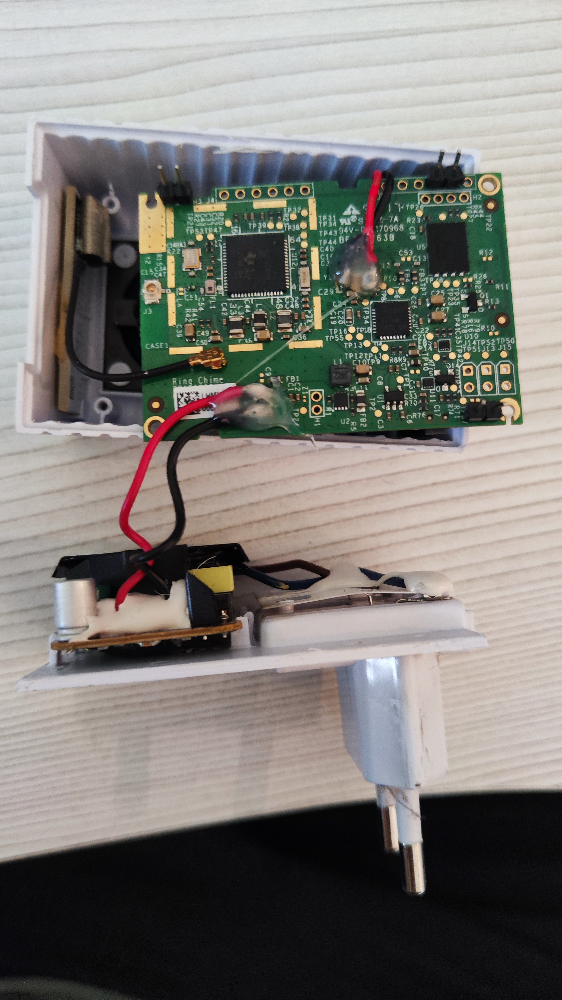
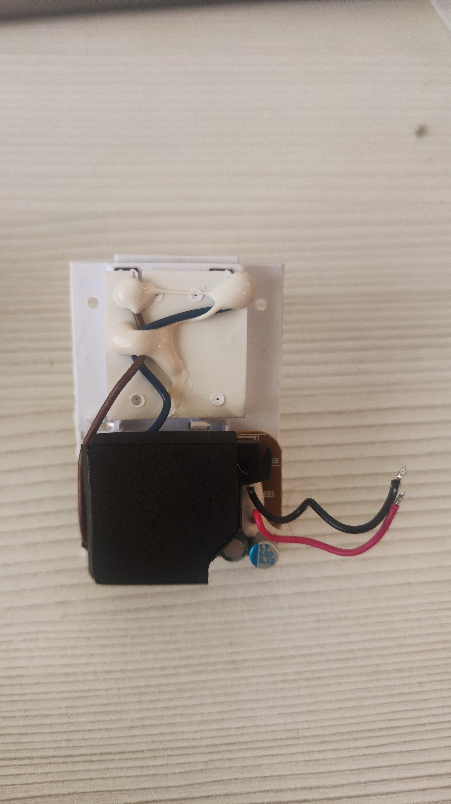
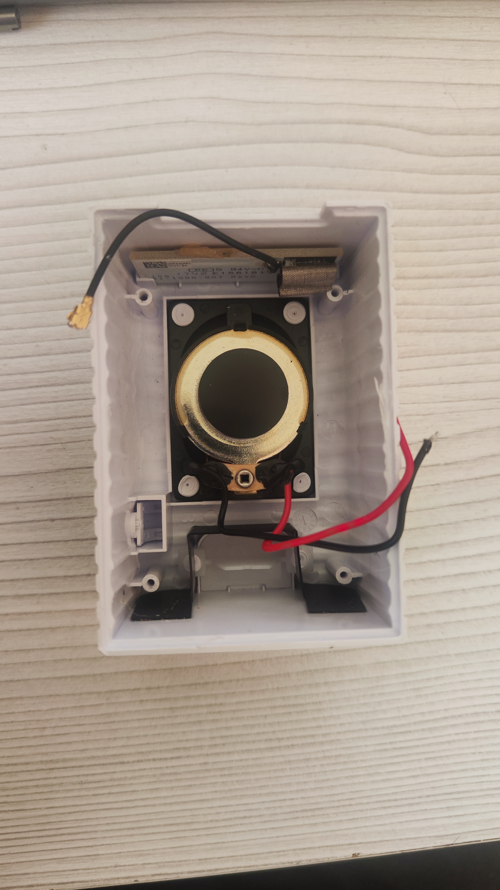
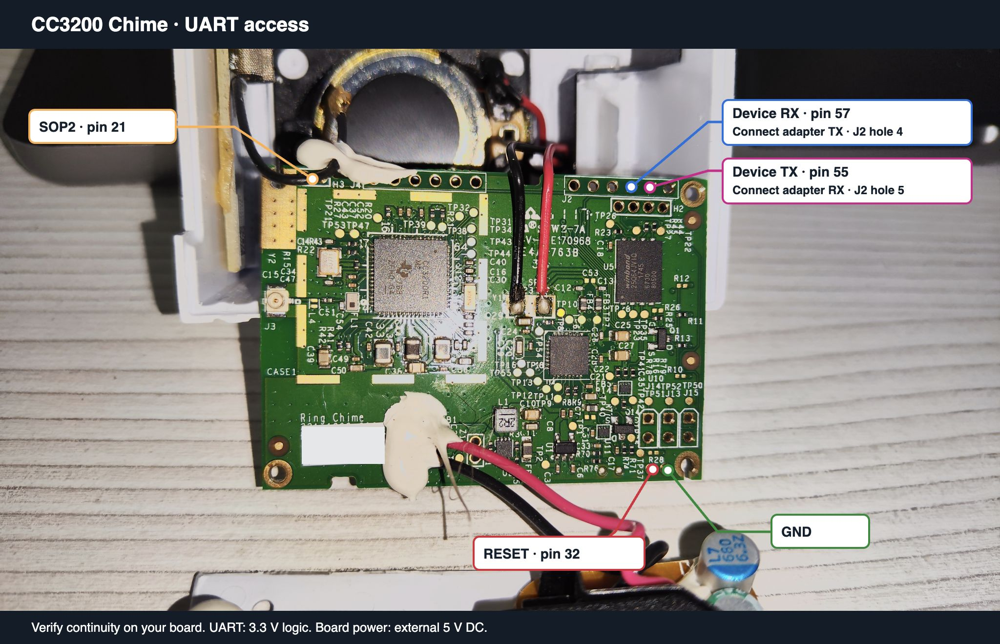

# Hardware preparation and useful findings

## Scope and power isolation

The board shown here contains a TI CC3200, a TLV320DAC3100 DAC/amplifier and
8 MiB of external serial flash. Other Chime revisions may differ. The original
power supply is a mains assembly: **unplug the unit before opening it, and
keep it unplugged throughout soldering, UART and bench tests.** Disconnect
both of its low-voltage output wires from the logic board before attaching
an external supply. Do not connect the open mains assembly to the wall while
the USB adapter or test leads are attached. Allow capacitors to discharge;
do not touch or work on the mains section.

The bench setup uses a regulated **5.0 V DC supply at the board's +5VDC
input**, plus **3.3 V UART logic**. Those are different electrical domains.
Never apply 5 V to RX, TX, SOP2 or RESET. The UART adapter provides data and
an optional SOP2 pull-up reference; it does not power the board.

## Prepare access before wiring

1. Photograph and label the power and speaker connections before desoldering.
2. Disconnect the original power supply's red/black output pair from the
   logic board. Identify +5VDC and GND by the board marking and continuity;
   do not use wire color alone as proof of polarity.
3. Optionally desolder the speaker pair temporarily to make the board easier
   to turn over, inspect and solder. The speaker can stay disconnected during
   programming and network tests. Reconnect both speaker wires before an
   audible playback test; do not connect either speaker output to GND.
4. Solder short header terminals suitable for Dupont jumper leads to the
   verified access points. This avoids holding loose wires against pads.
   Use flux, a fine tip and strain relief; check for solder bridges and
   continuity to adjacent pads with all power disconnected.
5. Keep the antenna and its coax connection intact. Do not use the coax as
   a handle when moving the board.

During flashing, the internal supply must remain disconnected from the
logic board.

## Accessible UART contacts

The UART contacts below were verified by continuity to the CC3200 pins and
tested with the ROM loader. Check continuity on your board before soldering
or applying power.

| Signal, as seen by the device | Physical CC3200 pin | Accessible point in the photo | Bench connection |
| --- | ---: | --- | --- |
| UART0 RX | 57 | J2 top row, fourth hole from the left | Adapter TXD |
| UART0 TX | 55 | J2 top row, fifth hole from the left | Adapter RXD |
| SOP2 | 21 | Left H3 area, partially below the antenna cable | 3.3 V through 4.7 kOhm |
| nRESET | 32 | Bottom edge, second small hole from the right | Momentary connection to GND |
| GND | — | Bottom edge, rightmost small hole before the mounting hole | Adapter GND and supply negative |
| +5VDC input | — | Original supply positive connection; marking was below a label | External supply +5.0 V |

Left and right refer to the annotated photo with the CC3200 on the left and
J2 at the top right. H3's exact pad number is not established; locate it by
continuity, not by assuming a connector numbering scheme. Do not confuse
J2 with the separate four-hole H2 row below it. Photo labels are device
RX/TX, so the adapter connections are crossed.

CC3200 package pin numbers are **one-based**. TI's `PIN_xx` constants are
zero-based internally: the numerical API argument 54 means physical pin 55.
Use the [TI CC3200 datasheet](https://www.ti.com/lit/ds/symlink/cc3200.pdf)
and the package pin-1 marker when counting.

## Audio and indicator findings

The audio and LED drivers use these pin assignments:

| Function | Physical CC3200 pin / interface | Finding |
| --- | --- | --- |
| I2C SCL / SDA | 3 / 4, mode 5 | DAC at 7-bit address `0x18`; normally 400 kHz |
| DAC reset | 18, GPIO28 | Low-to-high reset sequence |
| I2S data toward DAC | 50, mode 6 | Serializer 1 transmit |
| I2S bit clock | 62, mode 13 | 22,050 Hz audio configuration |
| I2S frame sync | 45, mode 12 | Stereo output words from mono input samples |
| Additional configured I2S pin | 64, mode 7 | No confirmed functional use |
| Blue indicator control | 2, GPIO11 | Firmware drives GPIO11 high; physical light unresolved |

The TLV320DAC3100 uses page/register writes. Page 1 register `0x20` is set
to `0x86` to enable the speaker amplifier and `0x06` to disable it. The
full initialization sequence is in `src/audio.c`. See the
[TI DAC datasheet](https://www.ti.com/lit/ds/symlink/tlv320dac3100.pdf).

Useful lessons from bring-up:

- Reproduce the board's GPIO setup and reset order before diagnosing an I2C
  failure as a damaged DAC. Controller timeout alone is not a confirmed NACK.
- Reset I2S, prepare DMA descriptors before enabling the FIFO, and wait for
  prefill before releasing frame synchronization. The shared DMA table must
  preserve SimpleLink's SPI channels.
- A completed HTTP request means the playback command was accepted. DMA
  progress and audible output are separate observations. Stalled playback
  must time out so configuration and OTA remain usable.
- `latch=1` in the LED diagnostic is the output register value, not a voltage
  measurement or proof of visible light. The `pad`/`oe` fields describe output
  configuration; the physical LED issue remains open.

The [CC3200 technical reference manual](https://www.ti.com/lit/ug/swru367d/swru367d.pdf)
documents the GPIO latch semantics and peripherals.
